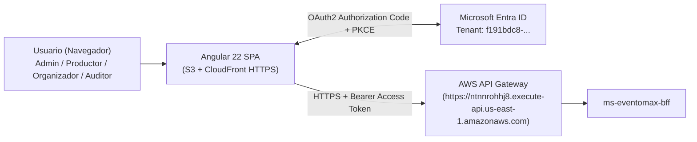

# frontend-eventomax — Portal Web Empresarial Angular 22 + MSAL Microsoft Entra ID (EP2)

**Asignatura:** Desarrollo Cloud Native I (`DSY1107`)
**Caso de Estudio:** Caso 8 — Plataforma de Producción y Montaje de Eventos (**EventoMax**)
**Equipo:** Ignacio Valeria, Benjamín Flores, Benjamín Espinoza

---

## 1. Propósito del Repositorio y Rol en EventoMax

`frontend-eventomax` es la aplicación de página única (**SPA en Angular 22**) que proporciona la experiencia operativa de **EventoMax EP2** para los cuatro roles del sistema (`Admin`, `Productor`, `Organizador`, `Auditor`):

1. **Autenticación Federada OAuth2 / OIDC con PKCE (`@azure/msal-angular`):** Inicia sesión contra **Microsoft Entra ID**, adquiere tokens de acceso para el scope `api://a1a87bcd-fed7-4d65-83c3-338389b80093/access_as_user` y los adjunta automáticamente hacia **AWS API Gateway** → **`ms-eventomax-bff`**.
2. **Gestión Integral de Producciones y Artefactos Asíncronos RabbitMQ:**
   - Creación de producciones, registro de contacto del organizador y contratación de servicios del catálogo.
   - Confirmación con reserva transaccional de equipamiento técnico.
   - Visualización de **Tickets de Cuadrilla Técnica** (`GET /api/productions/{id}/crew-ticket`) generados vía RabbitMQ al pasar a `EN_EJECUCION`.
   - Descarga directa del **Acta de Cierre y Cotización Formal en PDF** (`GET /api/productions/{id}/quote-pdf`) generada asíncronamente por `ms-eventomax-notify` (OpenPDF) al cerrar la producción (`CERRADO`).
3. **Catálogo e Inventario, Reportes Analíticos (ECharts) y Línea de Tiempo de Auditoría:** Vistas dedicadas con estados reactivos de carga, vacío, error y control de permisos por rol.

---

## 2. Arquitectura del Módulo y Diagrama



---

## 3. Stack Tecnológico y Versiones Reales (`package.json`)

| Componente | Tecnología / Paquete | Versión |
|---|---|---|
| Framework Frontend | `@angular/core`, `@angular/router`, `@angular/forms` | `^22.2.3` |
| Lenguaje | TypeScript | `~6.0.2` |
| Autenticación Entra ID | `@azure/msal-angular` / `@azure/msal-browser` | `^6.2.0` / `^5.21.0` |
| Visualización Analítica | `echarts` | `6.1.0` |
| Estilos e Iconografía | `tailwindcss` / `@lucide/angular` | `^4.3.3` / `^1.47.0` |
| Testing Unitario | `vitest` + `@angular/build:unit-test` | `^4.0.8` |
| Testing E2E | `@playwright/test` | `^1.64.1` |

---

## 4. Cumplimiento de Rúbrica EP2 (Matriz Caso 8)

| Criterio de Evaluación EP2 | Implementación en `frontend-eventomax` | Estado |
|---|---|---|
| **Integración con Flujos Asíncronos RabbitMQ** | Consulta de tickets de cuadrilla (`/crew-ticket`), gestión de contacto de organizador (`/api/organizers/{id}/contact`) y descarga binaria de Acta PDF (`/quote-pdf` con `responseType: 'blob'`). | **CUMPLIDO** |
| **Autenticación Microsoft Entra ID (SPA Pública)** | Configuración PKCE sin secretos en cliente, validación de `iss` y `aud` en `AuthorizationService`, guards (`MsalGuard`, `roleGuard`, `featureGuard`) e interceptor HTTP. | **CUMPLIDO** |
| **Build Productivo Listo para AWS S3 + CloudFront** | `environment.prod.ts` con `redirectUri` dinámico basado en `window.location.origin + '/index.html'` y `apiGatewayUrl` apuntando al API Gateway de AWS. | **CUMPLIDO** |

---

## 5. Rutas de la Aplicación y Control de Acceso

| Ruta SPA | Componente | Roles Autorizados | Endpoints BFF Consumidos |
|---|---|---|---|
| `/login` | `LoginComponent` | Público | Redirección MSAL a Microsoft Entra ID |
| `/dashboard` | `DashboardComponent` | `Admin`, `Productor`, `Organizador`, `Auditor` | `/api/productions`, `/api/catalog/services`, `/api/report/kpis` |
| `/productions` | `ProductionsComponent` | `Admin`, `Productor`, `Organizador` | `/api/productions/**`, `/api/organizers/{id}/contact`, `/api/catalog/reservations/**`, `/crew-ticket`, `/quote-pdf` |
| `/catalog` | `CatalogComponent` | `Admin`, `Productor`, `Organizador` | `/api/catalog/services/**`, `/api/catalog/equipment/**` |
| `/reports` | `ReportsComponent` | `Admin`, `Auditor` | `/api/report/kpis`, `/api/report/top-services` |
| `/audit` | `AuditComponent` | `Admin`, `Auditor` | `/api/audit/timeline` |
| `/forbidden` | `ForbiddenComponent` | Autenticado sin rol requerido | Diagnóstico de sesión y cierre seguro |

---

## 6. Configuración de Entornos (`src/environments/`)

- `environment.local.ts`: Usa proxy local (`/api` → `http://localhost:8081` vía `proxy.conf.json`) y `redirectUri: 'http://localhost:4200/'`.
- `environment.prod.ts`:
  - `apiGatewayUrl`: `https://ntnnrohhj8.execute-api.us-east-1.amazonaws.com`
  - `redirectUri` / `postLogoutRedirectUri`: `window.location.origin + '/index.html'`
  - **Cero secretos:** Contiene únicamente identificadores públicos OIDC (`tenantId`, `frontendClientId`, `apiScope`).

---

## 7. Ejecución Local y Pruebas Automatizadas

```bash
# 1. Instalar dependencias reproducibles
npm ci

# 2. Levantar servidor de desarrollo local con proxy hacia BFF (:8081)
npm run start:local

# 3. Ejecutar suite completa de pruebas unitarias Vitest (24 archivos, 199 tests)
npx ng test --watch=false

# 4. Generar build productivo optimizado para S3 / CloudFront
npm run build
```

**Resultado certificado en EP2:** `Test Files: 24 passed (24), Tests: 199 passed (199)` — Bundle productivo generado en `dist/frontend-eventomax/browser`.

---

## 8. Guía de Despliegue en AWS S3 + CloudFront HTTPS y Microsoft Entra ID

> **Nota crítica OAuth2 / MSAL:** Microsoft Entra ID exige **HTTPS** para cualquier `Redirect URI` de tipo `Single-page application (SPA)` que no sea `http://localhost`. El endpoint HTTP de S3 Static Website Hosting (`http://<bucket>.s3-website-us-east-1.amazonaws.com`) no es aceptado por Entra ID ni por WebCrypto PKCE en navegadores modernos. Por ello, el bucket S3 debe servirse detrás de una distribución **Amazon CloudFront con HTTPS** (`https://<dist-id>.cloudfront.net`).

### Pasos para Despliegue Futuro (cuando se autorice):
1. Sincronizar el directorio `dist/frontend-eventomax/browser` al bucket S3:
   ```bash
   aws s3 sync dist/frontend-eventomax/browser/ s3://<NOMBRE_BUCKET_FRONTEND>/ --delete
   ```
2. Configurar en CloudFront las páginas de error personalizadas (`403` y `404` → `/index.html` con código `200`) para soportar el enrutamiento SPA de Angular.
3. Registrar en **Microsoft Entra ID → App Registrations → `frontend-eventomax` → Authentication (Single-page application)**:
   - `https://<DOMINIO_CLOUDFRONT>/`
   - `https://<DOMINIO_CLOUDFRONT>/index.html`
4. Verificar que en **AWS API Gateway → CORS** esté permitido el origen `https://<DOMINIO_CLOUDFRONT>`.

---

## 9. Estado Actual de Certificación EP2 y Trazabilidad Jira

- **Pruebas Unitarias:** `199/199` aprobadas.
- **Build de Producción:** Exitoso (`dist/frontend-eventomax/browser`, `590.28 kB` raw / `146.79 kB` transfer).
- **Historias Jira:** `EMX-75/76` (Dashboards de Reportes y Auditoría), `EMX-Bloque-1A` (Catálogo, Equipos y Reservas), `T01` (Contratación de servicios y ranking), `EP2-FIX-01-B1` (Tickets de cuadrilla, contacto de organizador y descarga de Acta PDF).
