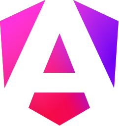
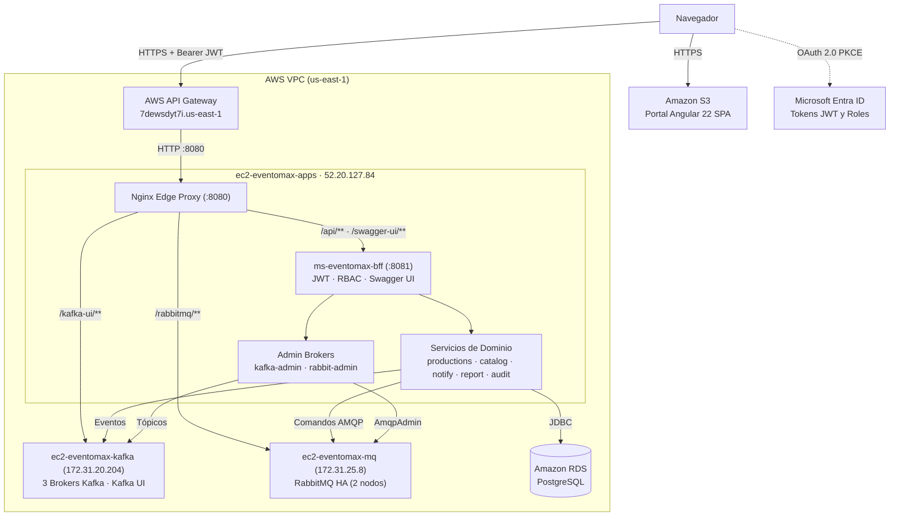
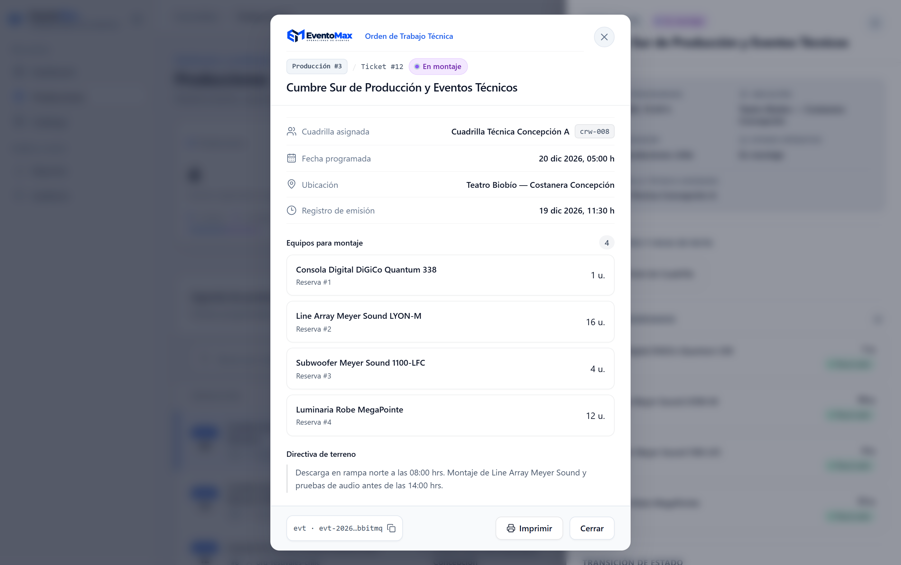

> **Caso de Estudio 8:** Plataforma B2B de Producción y Montaje de Eventos &nbsp;|&nbsp; **Asignatura:** Desarrollo Cloud Native (`DSY1107`) &nbsp;|&nbsp; **Equipo:** Ignacio Valeria, Benjamín Flores, Benjamín Espinoza

## Contexto del Proyecto

**EventoMax** centraliza la operación diaria de productoras de eventos masivos y empresas de montaje técnico sobre una arquitectura distribuida en **AWS (`us-east-1`)**.

El portal coordina el ciclo completo de cada producción (`SOLICITADO → CONFIRMADO → EN_MONTAJE → EN_EJECUCION → CERRADO`) junto con las reservas de equipamiento y servicios alojadas en **Amazon RDS PostgreSQL**.

Los procesos pesados y documentos operativos (órdenes de cuadrilla **Crew Ticket** y **Actas de Cierre en PDF**) se procesan de forma asíncrona mediante **RabbitMQ**, mientras que los cambios de estado viajan por **Apache Kafka** (`productions.events`) para alimentar el tablero de KPIs y el registro histórico de auditoría. Todo el tráfico hacia los microservicios pasa por `ms-eventomax-bff`, que valida los tokens JWT emitidos por **Microsoft Entra ID** y verifica la propiedad de los recursos antes de entregar archivos o datos sensibles.

## Accesos Directos (Demo en Vivo)

Todas las interfaces están expuestas bajo **HTTPS público** (Amazon S3 y AWS API Gateway hacia el Edge Reverse Proxy en EC2), por lo que funcionan desde cualquier computador institucional sin túneles ni configuración local.

| Interfaz | Enlace HTTPS | Usuario | Contraseña / Método |
| :--- | :--- | :--- | :--- |
| **Portal Web EventoMax** | [Abrir Portal Web](https://eventomax-production-portal-app.s3.us-east-1.amazonaws.com/index.html) | Cuenta Microsoft Entra ID | Login federado OAuth 2.0 (PKCE) |
| **Swagger UI (API BFF)** | [Abrir Swagger UI](https://7dewsdyt7i.execute-api.us-east-1.amazonaws.com/swagger-ui/index.html) · [JSON](https://7dewsdyt7i.execute-api.us-east-1.amazonaws.com/v3/api-docs) | Lectura pública | Para probar `/api/**`: botón **Authorize** con `Bearer <JWT>` |
| **Apache Kafka UI** | [Abrir Kafka UI](https://7dewsdyt7i.execute-api.us-east-1.amazonaws.com/kafka-ui/) | Sin login | Acceso directo al clúster `eventomax-cluster` |
| **RabbitMQ Management** | [Abrir RabbitMQ UI](https://7dewsdyt7i.execute-api.us-east-1.amazonaws.com/rabbitmq/) | `eventomax` | `eventomax` |

*Nota de operación: la infraestructura backend y de mensajería se ejecuta en **AWS Academy Learner Lab**. Antes de iniciar la demostración, verificar que el laboratorio y las instancias `ec2-eventomax-apps`, `ec2-eventomax-kafka` y `ec2-eventomax-mq` estén encendidas (`running`).*

## Roles y Control de Acceso (RBAC)

La autorización se aplica tanto en las rutas del frontend ([`src/app/app.routes.ts`](src/app/app.routes.ts)) como en cada endpoint del BFF a partir del claim `roles` del token de Microsoft Entra ID.

| Rol | Función en la Operación | Vistas Habilitadas | Alcance Principal |
| :--- | :--- | :--- | :--- |
| **`Admin`** | Administración general y gobierno técnico de la plataforma | `/dashboard`, `/productions`, `/catalog`, `/reports`, `/audit` | Gestión global de producciones, CRUD completo de catálogo, reportería ejecutiva, auditoría y administración de colas (`/api/rabbit-admin/**`) |
| **`Productor`** | Dirección técnica y coordinación operativa del montaje | `/dashboard`, `/productions`, `/catalog` | Cambio de estado de producciones, republicación de comandos hacia RabbitMQ, emisión de Crew Tickets, descarga de Actas PDF y consulta de catálogo |
| **`Organizador`** | Contraparte comercial responsable del evento | `/dashboard`, `/productions` | Creación de nuevas solicitudes de producción, actualización de contacto, seguimiento de reservas asociadas y descarga de Actas PDF |
| **`Auditor`** | Revisión de cumplimiento y trazabilidad operativa | `/dashboard`, `/audit` | Lectura del tablero operativo y consulta del historial cronológico de eventos registrados vía Kafka |

Las rutas `/portal` y `/login` son públicas. Si un usuario autenticado intenta acceder a un módulo fuera de su rol, la aplicación redirige a `/forbidden` y el BFF responde `403 Forbidden`.

## Stack e Infraestructura

<table>
  <tr>
    <td align="center" width="20%">
       
      <strong>Angular 22</strong>
    </td>
    <td align="center" width="20%">
       
      <strong>Entra ID (MSAL)</strong>
    </td>
    <td align="center" width="20%">
       
      <strong>Spring Boot BFF</strong>
    </td>
    <td align="center" width="20%">
      <picture>
        <source media="(prefers-color-scheme: dark)" srcset="public/branding/tech/apache-kafka-dark.svg" />
        
      </picture> 
      <strong>Apache Kafka 3.8</strong>
    </td>
    <td align="center" width="20%">
       
      <strong>RabbitMQ Cluster</strong>
    </td>
  </tr>
  <tr>
    <td align="center" width="20%">
       
      <strong>PostgreSQL</strong>
    </td>
    <td align="center" width="20%">
       
      <strong>Docker & Nginx</strong>
    </td>
    <td align="center" width="20%">
       
      <strong>API Gateway</strong>
    </td>
    <td align="center" width="20%">
       
      <strong>Amazon EC2 (×3)</strong>
    </td>
    <td align="center" width="20%">
       
      <strong>Amazon S3</strong>
    </td>
  </tr>
</table>

## Arquitectura en AWS

## Vistas del Portal

<table>
  <tr>
    <td width="50%">
      
      
<strong>Dashboard operativo</strong>

    </td>
    <td width="50%">
      
      
<strong>Gestión de producciones</strong>

    </td>
  </tr>
  <tr>
    <td width="50%">
      
      
<strong>Ticket de cuadrilla y Acta PDF</strong>

    </td>
    <td width="50%">
      
      
<strong>Auditoría de eventos (Kafka)</strong>

    </td>
  </tr>
</table>
