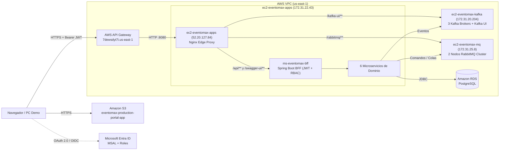
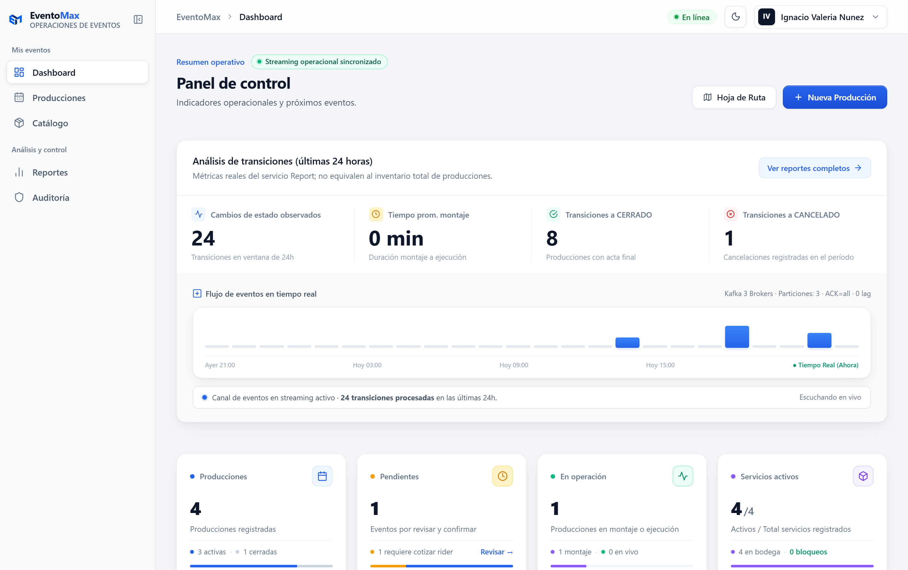
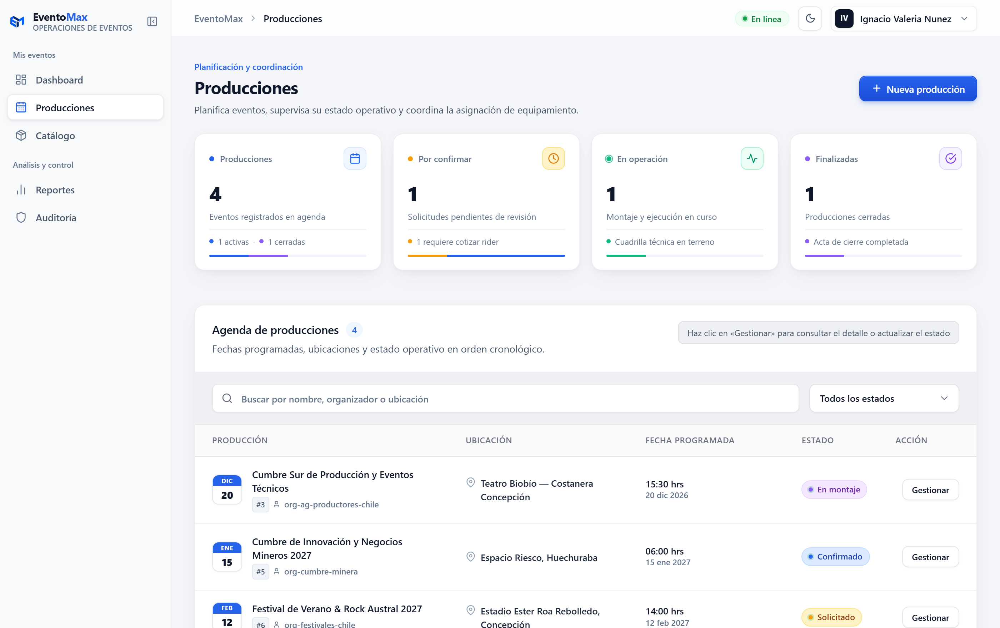

<div align="center">

<a href="https://eventomax-production-portal-app.s3.us-east-1.amazonaws.com/index.html">
  
</a>

<br />

[](https://eventomax-production-portal-app.s3.us-east-1.amazonaws.com/index.html)
[](https://7dewsdyt7i.execute-api.us-east-1.amazonaws.com/swagger-ui/index.html)
[](https://7dewsdyt7i.execute-api.us-east-1.amazonaws.com/kafka-ui/)
[](https://7dewsdyt7i.execute-api.us-east-1.amazonaws.com/rabbitmq/)

<p>
  <a href="#accesos-directos--demo-en-vivo"><strong>Accesos Demo</strong></a> •
  <a href="#stack-tecnológico-e-infraestructura-aws"><strong>Stack Tecnológico</strong></a> •
  <a href="#arquitectura-cloud-native"><strong>Arquitectura AWS</strong></a> •
  <a href="#galería-del-portal-en-producción"><strong>Galería</strong></a> •
  <a href="#control-de-acceso-rbac"><strong>Rutas y Roles</strong></a> •
  <a href="#desarrollo-y-despliegue"><strong>Despliegue</strong></a>
</p>

</div>

---

**EventoMax Production Portal** es el portal web operativo de arquitectura **Cloud Native** para la gestión integral de eventos masivos, producciones técnicas, control de acreditación, reportería ejecutiva y auditoría distribuida.

La plataforma está desplegada en **AWS (`us-east-1`)** bajo una arquitectura desacoplada: **SPA en Amazon S3**, **AWS API Gateway** como puerta de enlace HTTPS hacia **Nginx Edge Proxy**, **Backend-for-Frontend (BFF)** protegido con **Microsoft Entra ID (JWT + RBAC)**, **clúster Apache Kafka** y **clúster RabbitMQ**.

---

## Accesos Directos — Demo en Vivo

Todos los enlaces operan sobre **HTTPS público** (AWS API Gateway + Amazon S3), accesibles directamente desde cualquier equipo institucional sin depender de IPs locales ni túneles SSH.

| Interfaz / Servicio | Descripción | Enlace Directo |
| :--- | :--- | :--- |
| **Portal Web EventoMax** | Aplicación Angular SPA alojada en Amazon S3 | [**Abrir Portal Web**](https://eventomax-production-portal-app.s3.us-east-1.amazonaws.com/index.html) |
| **Swagger UI (BFF API)** | Documentación interactiva OpenAPI de todos los endpoints REST | [**Abrir Swagger UI**](https://7dewsdyt7i.execute-api.us-east-1.amazonaws.com/swagger-ui/index.html) |
| **OpenAPI 3 Spec (JSON)** | Esquema OpenAPI descargable para Postman / Insomnia | [**Ver JSON Spec**](https://7dewsdyt7i.execute-api.us-east-1.amazonaws.com/v3/api-docs) |
| **Apache Kafka UI** | Monitoreo en tiempo real del clúster `eventomax-cluster` (3 brokers, 6 tópicos, 65 particiones) | [**Abrir Kafka UI**](https://7dewsdyt7i.execute-api.us-east-1.amazonaws.com/kafka-ui/) |
| **RabbitMQ Management** | Consola de colas, exchanges y nodos del clúster AMQP | [**Abrir RabbitMQ UI**](https://7dewsdyt7i.execute-api.us-east-1.amazonaws.com/rabbitmq/) |

<details>
<summary><strong>Notas de acceso rápido para la Demo en vivo</strong></summary>

1. **Swagger UI (`/swagger-ui/index.html`)**: La documentación es de acceso público en modo lectura. Para probar endpoints `/api/**` desde **Try it out**, haz clic en **Authorize** e ingresa el `Bearer <access_token>` emitido por Microsoft Entra ID tras iniciar sesión en el Portal Web.
2. **Kafka UI (`/kafka-ui/`)**: Protegido por formulario de inicio de sesión (`LOGIN_FORM`) con usuario administrativo **`eventomax_admin`** (solicitar credencial al equipo presentador).
3. **RabbitMQ Management (`/rabbitmq/`)**: Enrutado bajo el prefijo `/rabbitmq/` a través de API Gateway y Nginx Edge Proxy sobre el clúster privado VPC.

</details>

---

## Stack Tecnológico e Infraestructura AWS

<table>
  <tr>
    <td align="center" width="160">
      <br />
      <strong>Angular 22</strong><br />
      <sub>SPA • TypeScript 6 • Tailwind 4</sub>
    </td>
    <td align="center" width="160">
      <br />
      <strong>Microsoft Entra ID</strong><br />
      <sub>MSAL • OAuth 2.0 • RBAC JWT</sub>
    </td>
    <td align="center" width="160">
      <br />
      <strong>Spring Boot</strong><br />
      <sub>BFF API • OpenAPI / Swagger</sub>
    </td>
    <td align="center" width="160">
      <br />
      <strong>Apache Kafka 3.8</strong><br />
      <sub>3 Brokers • 6 Tópicos • Kafka UI</sub>
    </td>
    <td align="center" width="160">
      <br />
      <strong>RabbitMQ</strong><br />
      <sub>Clúster HA 2 Nodos • AMQP</sub>
    </td>
  </tr>
  <tr>
    <td align="center" width="160">
      <br />
      <strong>PostgreSQL</strong><br />
      <sub>Persistencia Relacional • RDS</sub>
    </td>
    <td align="center" width="160">
      <br />
      <strong>Docker Compose</strong><br />
      <sub>Contenedores • Nginx Edge Proxy</sub>
    </td>
    <td align="center" width="160">
      <br />
      <strong>AWS API Gateway</strong><br />
      <sub>Punto Único HTTPS Público</sub>
    </td>
    <td align="center" width="160">
      <br />
      <strong>Amazon EC2 (×3)</strong><br />
      <sub>Apps • Clúster Kafka • Clúster MQ</sub>
    </td>
    <td align="center" width="160">
      <br />
      <strong>Amazon S3</strong><br />
      <sub>Hosting Estático SPA</sub>
    </td>
  </tr>
</table>

---

## Arquitectura Cloud Native



---

## Galería del Portal en Producción

<table>
  <tr>
    <td width="50%">
      
      <p align="center"><strong>Dashboard Ejecutivo</strong> — KPIs en vivo y gráficas Apache ECharts</p>
    </td>
    <td width="50%">
      
      <p align="center"><strong>Producciones</strong> — Ciclo operativo y asignación técnica</p>
    </td>
  </tr>
  <tr>
    <td width="50%">
      
      <p align="center"><strong>Crew & Ticketing</strong> — Gestión de personal, zonas y entradas</p>
    </td>
    <td width="50%">
      
      <p align="center"><strong>Auditoría Distribuida</strong> — Trazabilidad de eventos del ecosistema</p>
    </td>
  </tr>
</table>

---

## Control de Acceso (RBAC)

El enrutamiento definido en [`src/app/app.routes.ts`](src/app/app.routes.ts) protege cada vista mediante `msalGuard` y `roleGuard` según los claims emitidos por Microsoft Entra ID:

| Ruta | Visibilidad / Roles Permitidos | Función |
| :--- | :--- | :--- |
| `/portal` | Público | Landing institucional y acceso al portal |
| `/login` | Público | Flujo de autenticación corporativa MSAL |
| `/dashboard` | `Admin`, `Productor`, `Organizador`, `Auditor` | Tablero operativo y métricas clave |
| `/productions` | `Admin`, `Productor`, `Organizador` | Administración de eventos y producciones |
| `/catalog` | `Admin`, `Productor` | Catálogo de recursos, proveedores y servicios |
| `/reports` | `Admin` | Reportería consolidada de dirección |
| `/audit` | `Admin`, `Auditor` | Registro inmutable y trazabilidad de eventos |
| `/forbidden` | Autenticado | Pantalla de acceso denegado por falta de rol |

---

## Desarrollo y Despliegue

<details>
<summary><strong>Ejecución local, pruebas automatizadas y publicación en Amazon S3</strong></summary>

### Requisitos y Scripts Locales

- **Node.js 22+**, **npm** y configuración de entorno Angular en `src/environments/`.

```bash
# Instalación de dependencias
npm ci

# Servidor de desarrollo local (http://localhost:4200)
npm start

# Compilación de producción
npm run build

# Pruebas unitarias (Vitest) y End-to-End (Playwright)
npm test
npm run e2e
```

### Publicación del Frontend en Amazon S3

```bash
npm run build
aws s3 sync dist/frontend-eventomax/browser/ s3://eventomax-production-portal-app --delete
```

</details>

---

<div align="center">
  <sub><strong>EventoMax Cloud Native Platform</strong> • Frontend Angular SPA • Backend BFF • Apache Kafka • RabbitMQ • AWS</sub>
</div>
