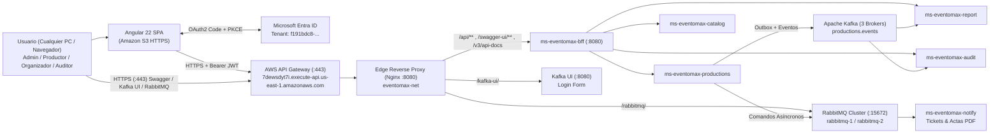

# EventoMax — Portal Web Operativo (Angular 22 + Microsoft Entra ID + AWS Cloud)

**Asignatura:** Desarrollo Cloud Native (`DSY1107`)  
**Caso de Estudio:** Caso 8 — Plataforma de Producción y Montaje de Eventos (**EventoMax**)  
**Equipo:** Ignacio Valeria, Benjamín Flores, Benjamín Espinoza

---

## 1. Enlaces Directos de Producción y Consolas UI (Demo en Vivo)

Todos los accesos operan vía **HTTPS (`:443`)** a través de **Amazon S3** y **AWS API Gateway → Edge Reverse Proxy (EC2)**, funcionando directamente desde cualquier navegador y red institucional sin requerir túneles SSH ni puertos locales abiertos:

| Recurso / UI | Propósito en Plataforma y Demo | URL Directa (HTTPS) | Control de Acceso |
| :--- | :--- | :--- | :--- |
| **Portal Web EventoMax** | SPA Angular 22 en Producción (Amazon S3) | https://eventomax-production-portal-app.s3.us-east-1.amazonaws.com/index.html | Login **Microsoft Entra ID** (PKCE) |
| **Swagger UI (OpenAPI 3)** | Documentación y pruebas REST (`GET`, `POST`, `PUT`, `DELETE`) del BFF | https://7dewsdyt7i.execute-api.us-east-1.amazonaws.com/swagger-ui/index.html | UI pública; ejecución `/api/**` vía botón **Authorize** (Bearer JWT) |
| **Kafka UI** | Inspección en vivo del clúster Kafka, tópico `productions.events` y DLT | https://7dewsdyt7i.execute-api.us-east-1.amazonaws.com/kafka-ui/ | Autenticación `LOGIN_FORM` |
| **RabbitMQ Management** | Clúster RabbitMQ 4.3.6 (2 nodos), exchanges, colas `q.cmd.*` y DLQ | https://7dewsdyt7i.execute-api.us-east-1.amazonaws.com/rabbitmq/ | Credenciales RabbitMQ Management |

> **Nota para evaluación:** Los servicios de backend, mensajería y bases de datos corren en **AWS Academy Learner Lab**. Asegúrate de que el laboratorio y la instancia EC2 estén iniciados antes de abrir los enlaces.

---

## 2. Arquitectura General de la Plataforma



---

## 3. Capacidades Principales Implementadas

1. **Autenticación Federada OAuth2 / OIDC con PKCE (`@azure/msal-angular`):**
   - Inicio de sesión corporativo contra Microsoft Entra ID sin secretos en cliente.
   - Adquisición automática de Access Token para `api://a1a87bcd-fed7-4d65-83c3-338389b80093/access_as_user` con control de acceso RBAC por roles (`Admin`, `Productor`, `Organizador`, `Auditor`).
2. **Gestión Integral de Producciones y Flujos Asíncronos (RabbitMQ + Kafka):**
   - Ciclo de vida operativo completo (`SOLICITADO → CONFIRMADO → EN_MONTAJE → EN_EJECUCION → CERRADO`).
   - Emisión de **Tickets de Cuadrilla Técnica** (`GET /api/productions/{id}/crew-ticket`) con orden de trabajo imprimible.
   - Descarga binaria de **Acta de Cierre / Cotización PDF** (`GET /api/productions/{id}/quote-pdf`) generada asíncronamente por `ms-eventomax-notify` (OpenPDF).
   - Proyección eventual en **Reportes (ECharts)** y **Auditoría Inmutable** consumiendo el tópico `productions.events` de Apache Kafka.
3. **Catálogo de Servicios y Equipamiento Persistido en PostgreSQL RDS:**
   - CRUD completo de servicios y equipos con gestión de inventario y reservas transaccionales.
   - Carga manual de fotografías reales optimizadas desde UI, persistidas en columna `image_url` (`TEXT`) en RDS para visibilidad inmediata entre todas las cuentas y dispositivos.

---

## 4. Rutas de la Aplicación y Control de Acceso

| Ruta SPA | Vista | Roles Autorizados | Endpoints BFF Consumidos |
| :--- | :--- | :--- | :--- |
| `/portal` | `Landing` | Público | Portal informativo y acceso |
| `/login` | `Login` | Público | Redirección MSAL a Microsoft Entra ID |
| `/dashboard` | `Dashboard` | `Admin`, `Productor`, `Organizador`, `Auditor` | `/api/productions`, `/api/catalog/services`, `/api/report/kpis` |
| `/productions` | `Productions` | `Admin`, `Productor`, `Organizador` | `/api/productions/**`, `/api/organizers/{id}/contact`, `/api/catalog/reservations/**`, `/crew-ticket`, `/quote-pdf` |
| `/catalog` | `Catalog` | `Admin`, `Productor` | `/api/catalog/services/**`, `/api/catalog/equipment/**` |
| `/reports` | `Reports` | `Admin` | `/api/report/kpis`, `/api/report/top-services` |
| `/audit` | `Audit` | `Admin`, `Auditor` | `/api/audit/timeline` |
| `/forbidden` | `Forbidden` | Autenticado sin rol requerido | Diagnóstico de sesión y cierre seguro |

---

## 5. Stack Tecnológico (`package.json`)

| Componente | Tecnología / Paquete | Versión |
| :--- | :--- | :--- |
| Framework Frontend | `@angular/core`, `@angular/router`, `@angular/forms` | `^22.2.3` |
| Lenguaje | `TypeScript` | `~6.0.2` |
| Autenticación Entra ID | `@azure/msal-angular` / `@azure/msal-browser` | `^6.2.0` / `^5.21.0` |
| Visualización Analítica | `echarts` | `6.1.0` |
| Estilos e Iconografía | `tailwindcss` / `@lucide/angular` | `^4.3.3` / `^1.47.0` |
| Testing Unitario | `vitest` + `@angular/build` | `^4.0.8` |
| Testing E2E | `@playwright/test` | `^1.64.1` |

---

## 6. Ejecución Local, Pruebas y Despliegue en Amazon S3

```bash
# 1. Instalar dependencias reproducibles
npm ci

# 2. Servidor de desarrollo local (proxy hacia BFF local)
npm run start:local

# 3. Ejecutar suite completa de pruebas unitarias Vitest (36 archivos, 263 tests)
npx ng test --watch=false

# 4. Generar bundle productivo optimizado para Amazon S3
npm run build
```

### Publicación del Frontend en Amazon S3 (`eventomax-production-portal-app`)

1. Subir el contenido compilado de `dist/frontend-eventomax/browser/` a la raíz del bucket **`eventomax-production-portal-app`** (`us-east-1`).
2. Sincronizar los alias HTML5 en **AWS CloudShell** para soportar recarga directa en rutas virtuales sin CloudFront:
   ```bash
   for route in portal login dashboard productions catalog reports audit forbidden landing; do
     aws s3 cp s3://eventomax-production-portal-app/index.html s3://eventomax-production-portal-app/$route \
       --content-type "text/html" --cache-control "no-cache" --metadata-directive REPLACE
   done
   ```
