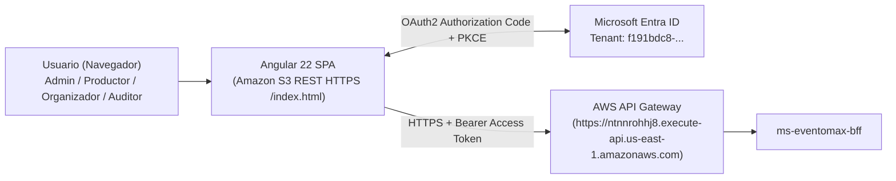

# frontend-eventomax — Portal Web Empresarial Angular 22 + MSAL Microsoft Entra ID (EP2)

**Asignatura:** Desarrollo Cloud Native I (`DSY1107`)
**Caso de Estudio:** Caso 8 — Plataforma de Producción y Montaje de Eventos (**EventoMax**)
**Equipo:** Ignacio Valeria, Benjamín Flores, Benjamín Espinoza

---

## 1. Propósito del Repositorio y Rol en EventoMax

`frontend-eventomax` es la aplicación de página única (**SPA en Angular 22**) que proporciona la experiencia operativa de **EventoMax EP2** para los cuatro roles del sistema (`Admin`, `Productor`, `Organizador`, `Auditor`):

1. **Autenticación Federada OAuth2 / OIDC con PKCE (`@azure/msal-angular`):** Inicia sesión contra **Microsoft Entra ID**, adquiere tokens de acceso para el scope `api://a1a87bcd-fed7-4d65-83c3-338389b80093/access_as_user` y los adjunta automáticamente hacia **AWS API Gateway** → **`ms-eventomax-bff`**.
2. **Gestión Integral de Producciones y Artefactos Asíncronos RabbitMQ:**
   - Creación de producciones, registro de contacto del organizador y contratación de servicios del catálogo.
   - Confirmación con reserva transaccional de equipamiento técnico.
   - Visualización de **Tickets de Cuadrilla Técnica** (`GET /api/productions/{id}/crew-ticket`) generados vía RabbitMQ al pasar a `EN_EJECUCION`.
   - Descarga directa del **Acta de Cierre y Cotización Formal en PDF** (`GET /api/productions/{id}/quote-pdf`) generada asíncronamente por `ms-eventomax-notify` (OpenPDF) al cerrar la producción (`CERRADO`).
3. **Catálogo e Inventario, Reportes Analíticos (ECharts) y Línea de Tiempo de Auditoría:** Vistas dedicadas con estados reactivos de carga, vacío, error y control de permisos por rol.

---

## 2. Arquitectura del Módulo y Diagrama



---

## 3. Stack Tecnológico y Versiones Reales (`package.json`)

| Componente | Tecnología / Paquete | Versión |
|---|---|---|
| Framework Frontend | `@angular/core`, `@angular/router`, `@angular/forms` | `^22.2.3` |
| Lenguaje | TypeScript | `~6.0.2` |
| Autenticación Entra ID | `@azure/msal-angular` / `@azure/msal-browser` | `^6.2.0` / `^5.21.0` |
| Visualización Analítica | `echarts` | `6.1.0` |
| Estilos e Iconografía | `tailwindcss` / `@lucide/angular` | `^4.3.3` / `^1.47.0` |
| Testing Unitario | `vitest` + `@angular/build:unit-test` | `^4.0.8` |
| Testing E2E | `@playwright/test` | `^1.64.1` |

---

## 4. Cumplimiento de Rúbrica EP2 (Matriz Caso 8)

| Criterio de Evaluación EP2 | Implementación en `frontend-eventomax` | Estado |
|---|---|---|
| **Integración con Flujos Asíncronos RabbitMQ** | Consulta de tickets de cuadrilla (`/crew-ticket`), gestión de contacto de organizador (`/api/organizers/{id}/contact`) y descarga binaria de Acta PDF (`/quote-pdf` con `responseType: 'blob'`). | **CUMPLIDO** |
| **Autenticación Microsoft Entra ID (SPA Pública)** | Configuración PKCE sin secretos en cliente, validación de `iss` y `aud` en `AuthorizationService`, guards (`MsalGuard`, `roleGuard`, `featureGuard`) e interceptor HTTP. | **CUMPLIDO** |
| **Build Productivo Listo para Amazon S3 HTTPS (Preservando Configuración EP1, Sin CloudFront)** | `environment.prod.ts` con `redirectUri` y `postLogoutRedirectUri` apuntando a `window.location.origin + '/index.html'`, redirección `{ path: 'index.html', redirectTo: 'login', pathMatch: 'full' }` en `app.routes.ts` y `apiGatewayUrl` apuntando al API Gateway de AWS (`ntnnrohhj8`). | **CUMPLIDO** |

---

## 5. Rutas de la Aplicación y Control de Acceso

| Ruta SPA | Componente | Roles Autorizados | Endpoints BFF Consumidos |
|---|---|---|---|
| `/login` | `LoginComponent` | Público | Redirección MSAL a Microsoft Entra ID |
| `/dashboard` | `DashboardComponent` | `Admin`, `Productor`, `Organizador`, `Auditor` | `/api/productions`, `/api/catalog/services`, `/api/report/kpis` |
| `/productions` | `ProductionsComponent` | `Admin`, `Productor`, `Organizador` | `/api/productions/**`, `/api/organizers/{id}/contact`, `/api/catalog/reservations/**`, `/crew-ticket`, `/quote-pdf` |
| `/catalog` | `CatalogComponent` | `Admin`, `Productor`, `Organizador` | `/api/catalog/services/**`, `/api/catalog/equipment/**` |
| `/reports` | `ReportsComponent` | `Admin`, `Auditor` | `/api/report/kpis`, `/api/report/top-services` |
| `/audit` | `AuditComponent` | `Admin`, `Auditor` | `/api/audit/timeline` |
| `/forbidden` | `ForbiddenComponent` | Autenticado sin rol requerido | Diagnóstico de sesión y cierre seguro |

---

## 6. Configuración de Entornos (`src/environments/`)

- `environment.local.ts`: Usa proxy local (`/api` → `http://localhost:8081` vía `proxy.conf.json`) y `redirectUri: 'http://localhost:4200/'`.
- `environment.prod.ts`:
  - `apiGatewayUrl`: `https://ntnnrohhj8.execute-api.us-east-1.amazonaws.com`
  - `redirectUri` / `postLogoutRedirectUri`: `window.location.origin + '/index.html'`
  - **Cero secretos:** Contiene únicamente identificadores públicos OIDC (`tenantId`, `frontendClientId`, `apiScope`).

---

## 7. Ejecución Local y Pruebas Automatizadas

```bash
# 1. Instalar dependencias reproducibles
npm ci

# 2. Levantar servidor de desarrollo local con proxy hacia BFF (:8081)
npm run start:local

# 3. Ejecutar suite completa de pruebas unitarias Vitest (24 archivos, 199 tests)
npx ng test --watch=false

# 4. Generar build productivo optimizado para Amazon S3
npm run build
```

**Resultado certificado en EP2:** `Test Files: 24 passed (24), Tests: 199 passed (199)` y `21/21` pruebas Playwright E2E aprobadas — Bundle productivo generado en `dist/frontend-eventomax/browser`.

---

## 8. Guía de Publicación Manual en Amazon S3 (Preservando Configuración Aprobada en EP1, Sin CloudFront)

> **Preservación de la arquitectura de hosting EP1:** En el Sandbox académico de AWS no está permitido utilizar Amazon CloudFront. Se preserva íntegramente el procedimiento y configuración de **Amazon S3 + Microsoft Entra ID (MSAL)** que fue certificado y aprobado en la **EP1**:
> - **Bucket S3 existente de EP1:** `eventomax-frontend-085765167202-us-east-1` (región `us-east-1`).
> - **URL HTTPS del frontend en S3:** `https://eventomax-frontend-085765167202-us-east-1.s3.us-east-1.amazonaws.com/index.html` (o `/login` si se mantiene el objeto alias de EP1 en el bucket).
> - **Redirect URI y Post-Logout Redirect URI en `environment.prod.ts`:** `window.location.origin + '/index.html'` (`https://eventomax-frontend-085765167202-us-east-1.s3.us-east-1.amazonaws.com/index.html`), respaldado en `app.routes.ts` por `{ path: 'index.html', redirectTo: 'login', pathMatch: 'full' }`.

### Funcionamiento del flujo S3 + MSAL + Angular Router (EP1/EP2):
1. El usuario abre `https://eventomax-frontend-085765167202-us-east-1.s3.us-east-1.amazonaws.com/index.html` (S3 entrega el objeto `index.html` por HTTPS con `200 OK`) y Angular redirige en el cliente a `/login`.
2. Al iniciar sesión con **Microsoft Entra ID**, el flujo OAuth 2.0 Authorization Code + PKCE retorna a `https://eventomax-frontend-085765167202-us-east-1.s3.us-east-1.amazonaws.com/index.html` (objeto físico existente en S3).
3. `MsalRedirectComponent` procesa la respuesta de autenticación y la navegación posterior entre `/dashboard`, `/productions`, `/catalog`, `/reports`, `/audit` y `/rabbit-admin` ocurre íntegramente en el navegador mediante el router de Angular (`History API`), sin solicitar nuevos documentos HTML a S3.
4. Al cerrar sesión (`logoutRedirect`), Microsoft Entra ID redirige nuevamente a `/index.html` y Angular lleva al usuario a `/login`.
5. **Consideración operativa en S3 sin CloudFront:** Durante la demostración se debe ingresar siempre desde `/index.html` y navegar mediante el menú lateral de la SPA (evitando recargar con `F5` directamente sobre rutas virtuales como `/productions` o `/catalog`, salvo que en el bucket exista una copia de `index.html` con esa clave).

### Pasos para Actualización Manual en AWS Management Console (Sin AWS CLI):
1. Ingresar a **AWS Management Console → Amazon S3 → Buckets → `eventomax-frontend-085765167202-us-east-1`**.
2. Preservar intactos los permisos públicos y la *Bucket Policy* ya configurados en EP1.
3. Hacer clic en **Upload** y arrastrar el contenido compilado de `dist/frontend-eventomax/browser/` (disponible también en `.local-cert/ep2-aws-final-release/frontend-s3/browser/`): `index.html`, `main-*.js`, `chunk-*.js`, `styles-*.css`, `favicon.ico` y la carpeta `branding/`.
4. Mantener sin cambios la configuración aprobada en **Microsoft Entra ID** (`App Registration: b577f07b-edd6-4c6c-8306-93aba3c6feba`, SPA Redirect URI `https://eventomax-frontend-085765167202-us-east-1.s3.us-east-1.amazonaws.com/index.html`) y el origen **CORS** en **AWS API Gateway (`ntnnrohhj8`)** (`https://eventomax-frontend-085765167202-us-east-1.s3.us-east-1.amazonaws.com`).

---

## 9. Estado Actual de Certificación EP2 y Trazabilidad Jira

- **Pruebas Unitarias (Vitest):** `199/199` aprobadas (`24` archivos).
- **Pruebas E2E (Playwright):** `21/21` aprobadas.
- **Build de Producción:** Exitoso (`dist/frontend-eventomax/browser`, `590.28 kB` raw / `146.79 kB` transfer).
- **Verificación en AWS Real:** Preparado localmente preservando la configuración S3 + MSAL aprobada en EP1; pendiente de subida manual por el usuario en consola AWS S3.
- **Historias Jira:** `EMX-75/76` (Dashboards de Reportes y Auditoría), `EMX-Bloque-1A` (Catálogo, Equipos y Reservas), `T01` (Contratación de servicios y ranking), `EP2-FIX-01-B1` (Tickets de cuadrilla, contacto de organizador y descarga de Acta PDF).
