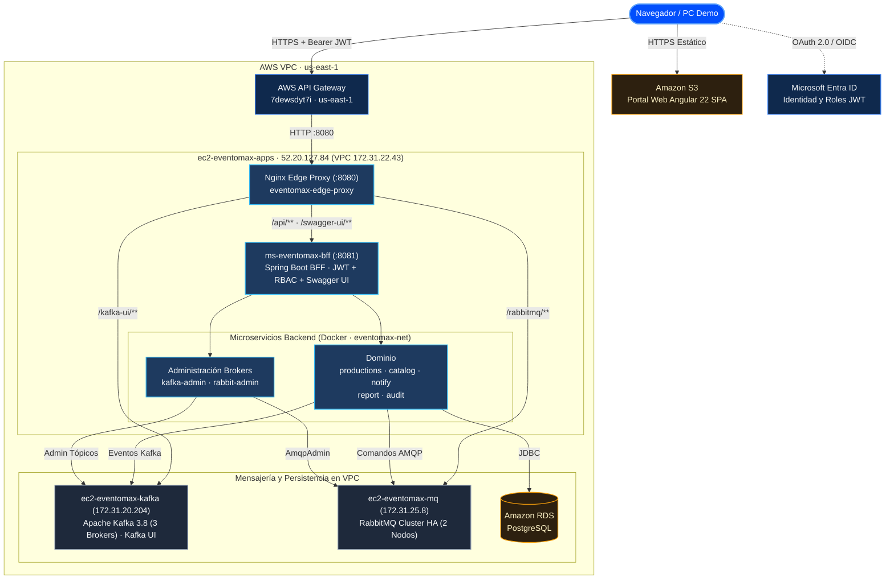
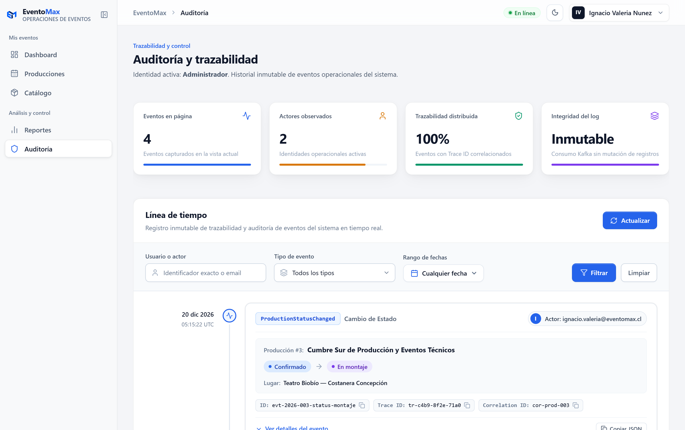

 

  <a href="#contexto-del-caso--eventomax"><strong>Contexto</strong></a> •
  <a href="#accesos-directos--demo-en-vivo"><strong>Accesos Demo</strong></a> •
  <a href="#roles-y-gobierno-de-acceso-rbac"><strong>Roles RBAC</strong></a> •
  <a href="#stack-tecnológico-e-infraestructura-aws"><strong>Stack y AWS</strong></a> •
  <a href="#arquitectura-cloud-native"><strong>Arquitectura</strong></a> •
  <a href="#galería-del-portal"><strong>Galería</strong></a>

  <strong>Caso 8:</strong> Plataforma de Producción y Montaje de Eventos &nbsp;|&nbsp;
  <strong>Asignatura:</strong> Desarrollo Cloud Native (<code>DSY1107</code>) &nbsp;|&nbsp;
  <strong>Equipo:</strong> Ignacio Valeria · Benjamín Flores · Benjamín Espinoza

---

## Contexto del Caso — EventoMax

**EventoMax** es una plataforma **SaaS B2B** diseñada para productoras de eventos masivos y empresas de montaje técnico que requieren coordinar operaciones críticas en tiempo real, trazabilidad documental y control de acceso corporativo sobre infraestructura **Cloud Native en AWS (`us-east-1`)**.

- **Ciclo Operativo End-to-End:** Administra producciones técnicas desde su solicitud hasta el cierre (`SOLICITADO → CONFIRMADO → EN_MONTAJE → EN_EJECUCION → CERRADO`), integrando catálogo de equipamiento y reservas en **Amazon RDS PostgreSQL**.
- **Mensajería Híbrida Desacoplada:**
  - **RabbitMQ Cluster HA (Comandos y DLQ):** Orquesta tareas asíncronas de notificación, emisión de **Tickets de Cuadrilla** (`/crew-ticket`), generación de **Actas de Cierre PDF** (`/quote-pdf`) y administración programática con `AmqpAdmin`.
  - **Apache Kafka (Event-Driven + DLT):** Transmite eventos de dominio (`productions.events`) hacia proyecciones analíticas de **KPIs ejecutivos** y un registro de **Auditoría distribuida inmutable**.
- **Seguridad Defense-in-Depth:** Autenticación federada con **Microsoft Entra ID (OAuth 2.0 + PKCE)** en el frontend Angular 22 y validación criptográfica de JWT, scopes y verificación de propiedad (**anti-IDOR**) en el **Backend-for-Frontend (`ms-eventomax-bff`)**.

---

## Accesos Directos — Demo en Vivo

Todos los endpoints y consolas operan sobre **HTTPS público** (Amazon S3 + AWS API Gateway → Nginx Edge Proxy), listos para abrir desde cualquier PC institucional sin túneles ni configuraciones locales:

| Interfaz UI | Acceso HTTPS | Credenciales / Autenticación |
| :--- | :--- | :--- |
| **Portal Web EventoMax** SPA Angular • Flujo operativo, producciones, catálogo y auditoría | [**Abrir Portal Web**](https://eventomax-production-portal-app.s3.us-east-1.amazonaws.com/index.html) | **SSO Microsoft Entra ID** OAuth 2.0 + PKCE (cuentas asignadas por rol) |
| **Swagger UI (API BFF)** Endpoints REST `GET`/`POST`/`PUT`/`DELETE` • [Spec OpenAPI JSON](https://7dewsdyt7i.execute-api.us-east-1.amazonaws.com/v3/api-docs) | [**Abrir Swagger UI**](https://7dewsdyt7i.execute-api.us-east-1.amazonaws.com/swagger-ui/index.html) | **Lectura pública** Probar `/api/**`: botón **Authorize** → `Bearer <JWT>` |
| **Apache Kafka UI** `eventomax-cluster` • 3 brokers, 6 tópicos, 65 particiones | [**Abrir Kafka UI**](https://7dewsdyt7i.execute-api.us-east-1.amazonaws.com/kafka-ui/) | Usuario: `eventomax_admin` Clave: `EventoMax2026!` |
| **RabbitMQ Management** Clúster HA 2 nodos • Exchanges, colas `q.cmd.*` y DLQs | [**Abrir RabbitMQ UI**](https://7dewsdyt7i.execute-api.us-east-1.amazonaws.com/rabbitmq/) | Usuario: `eventomax` Clave: `eventomax` |

> **Requisito para evaluación:** La capa backend, brokers y base de datos corren sobre **AWS Academy Learner Lab** (`ec2-eventomax-apps`, `ec2-eventomax-kafka`, `ec2-eventomax-mq`); verificar que el laboratorio y las 3 instancias EC2 estén en estado `running` antes de la demo.

---

## Roles y Gobierno de Acceso (RBAC)

La plataforma aplica autorización granular por **App Roles** emitidos en el JWT de **Microsoft Entra ID** (`EntraJwtAuthoritiesConverter` + guards Angular en [`src/app/app.routes.ts`](src/app/app.routes.ts)):

| Rol Corporativo | Responsabilidad en el Negocio | Vistas SPA Habilitadas | Capacidades Clave en API / Plataforma |
| :--- | :--- | :--- | :--- |
| **`Admin`** | Dirección general, gobierno de plataforma y operación de infraestructura | `/dashboard`, `/productions`, `/catalog`, `/reports`, `/audit` | Control total de producciones, CRUD completo del catálogo (`POST`/`PUT`), reportería de KPIs (`/api/report/**`), auditoría y administración programática de colas (`/api/rabbit-admin/**`) |
| **`Productor`** | Jefe técnico y operativo del montaje y coordinación en terreno | `/dashboard`, `/productions`, `/catalog` | Gestión de ciclo de vida y estados (`PUT /status`), republicación de comandos RabbitMQ, emisión de **Crew Tickets**, Actas PDF y consulta de catálogo |
| **`Organizador`** | Gestor comercial / cliente responsable del evento y su alcance | `/dashboard`, `/productions` | Creación de nuevas producciones (`POST /productions`), actualización de contacto, seguimiento de estado, reservas asociadas y descarga de **Acta PDF** |
| **`Auditor`** | Fiscalización, cumplimiento normativo y trazabilidad operativa | `/dashboard`, `/audit` | Visibilidad ejecutiva de solo lectura en tablero operativo y consulta del timeline inmutable de eventos consumidos desde Kafka (`/api/audit/timeline`) |

> Las rutas `/portal` y `/login` son públicas para ingreso federado; cualquier acceso autenticado sin el rol requerido es redirigido determinísticamente a `/forbidden` y rechazado por el BFF con `403 Forbidden`.

---

## Stack Tecnológico e Infraestructura AWS

<table>
  <tr>
    <td align="center" width="20%">
       
      <strong>Angular 22</strong> 
      SPA • TypeScript 6 • Tailwind 4
    </td>
    <td align="center" width="20%">
       
      <strong>Microsoft Entra ID</strong> 
      MSAL • OAuth 2.0 • RBAC JWT
    </td>
    <td align="center" width="20%">
       
      <strong>Spring Boot</strong> 
      BFF API • OpenAPI / Swagger
    </td>
    <td align="center" width="20%">
       
      <strong>Apache Kafka 3.8</strong> 
      3 Brokers • 6 Tópicos • Kafka UI
    </td>
    <td align="center" width="20%">
       
      <strong>RabbitMQ</strong> 
      Clúster HA 2 Nodos • AMQP
    </td>
  </tr>
  <tr>
    <td align="center" width="20%">
       
      <strong>PostgreSQL</strong> 
      Persistencia Relacional • RDS
    </td>
    <td align="center" width="20%">
       
      <strong>Docker Compose</strong> 
      Contenedores • Nginx Edge Proxy
    </td>
    <td align="center" width="20%">
       
      <strong>AWS API Gateway</strong> 
      Punto Único HTTPS Público
    </td>
    <td align="center" width="20%">
       
      <strong>Amazon EC2 (×3)</strong> 
      Apps • Clúster Kafka • Clúster MQ
    </td>
    <td align="center" width="20%">
       
      <strong>Amazon S3</strong> 
      Hosting Estático SPA
    </td>
  </tr>
</table>

---

## Arquitectura Cloud Native

---

## Galería del Portal

<table>
  <tr>
    <td width="50%">
      
      
<strong>Dashboard Ejecutivo</strong> — KPIs operativos y gráficas Apache ECharts

    </td>
    <td width="50%">
      
      
<strong>Producciones</strong> — Ciclo operativo, reservas y asignación técnica

    </td>
  </tr>
  <tr>
    <td width="50%">
      
      
<strong>Crew Ticket & Actas PDF</strong> — Órdenes de cuadrilla y documentos asíncronos

    </td>
    <td width="50%">
      
      
<strong>Auditoría Distribuida</strong> — Trazabilidad inmutable de eventos Kafka

    </td>
  </tr>
</table>
